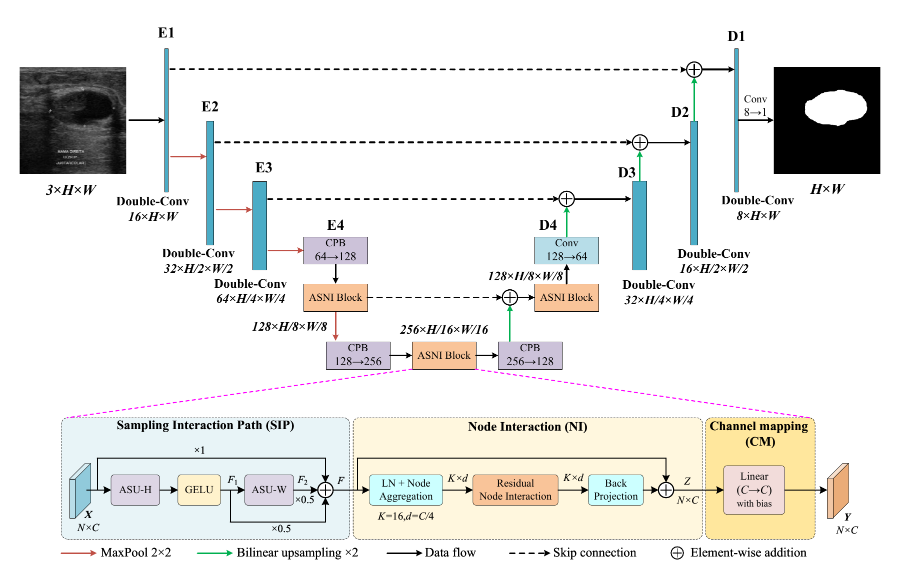
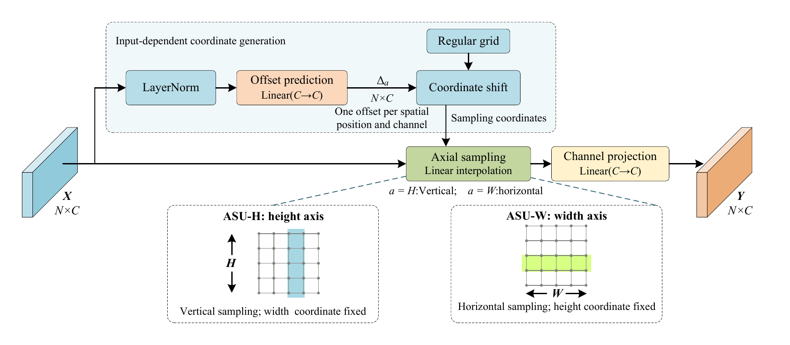
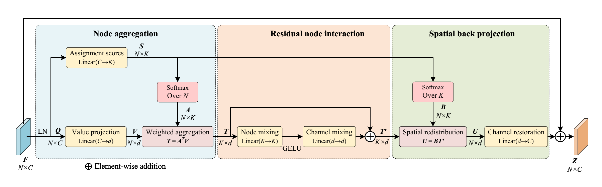
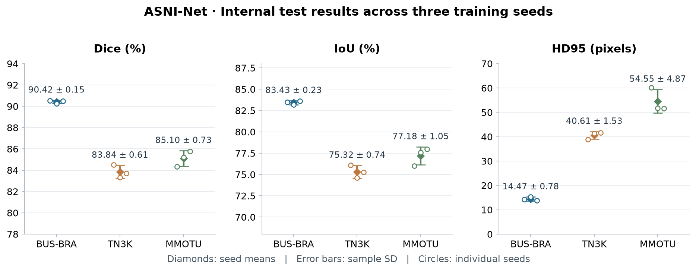
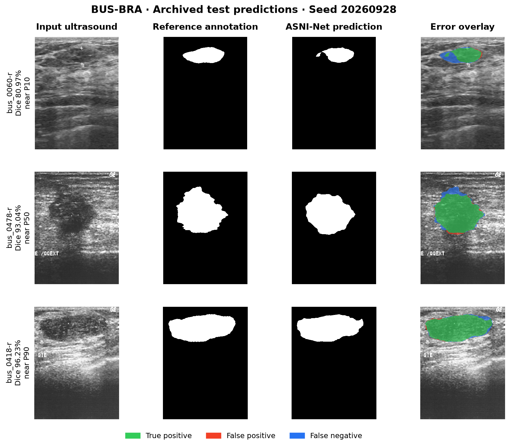

<div align="center">

# ASNI-Net

### An Adaptive Sampling and Node Interaction Network<br>for 2D Ultrasound Lesion Segmentation

**Input-dependent axial sampling · Compact node interaction · Reproducible experiments**

[](https://github.com/asni-review-code/ASNI-Net-review/actions/workflows/tests.yml)

[Paper-to-code guide](docs/PAPER_TO_CODE.md) · [Results](#experimental-results) · [Quick start](#quick-start) · [Weights](docs/MODEL_ZOO.md)

</div>

ASNI-Net is a compact encoder–decoder for segmenting breast, thyroid and ovarian
lesions in 2D ultrasound. Each **ASNI block** connects the **Sampling Interaction
Path (SIP)**, **Node Interaction (NI)** and **channel mapping (CM)** in sequence.
This repository accompanies the manuscript **“ASNI-Net: An Adaptive Sampling and
Node Interaction Network for 2D Ultrasound Lesion Segmentation.”**

This repository is provided for peer review. Final author and bibliographic
details will be added after review.

The repository provides the formal model, nine training configurations and checkpoints,
fixed data splits, original-resolution evaluation, and per-image reference results.
Models are trained separately for each dataset. The architecture contains
**1.45M registered parameters**, uses **16 nodes**, and accepts **512 × 512** inputs.

## Architecture



**Manuscript Figure 1.** A convolutional encoder–decoder with additive skip
connections and three ASNI blocks (128 / 256 / 128 channels). The lower panel
expands SIP → NI → CM. Layer normalization after each ASNI block and training
dropout are omitted from the drawing, as stated in the manuscript caption.
[Vector figure](assets/architecture.pdf) · [Implementation](asni_net/model.py)

<details>
<summary><b>Adaptive sampling and node interaction — manuscript Figures 2 and 3</b></summary>



**SIP / Figure 2.** Sampling first follows the height axis and then the width
axis; width offsets depend on the height-stage features. The path fuses
`X + 0.5 F1 + 0.5 F2`.



**NI / Figure 3.** The same assignment scores produce aggregation weights
normalized over spatial positions and redistribution weights normalized over
nodes. K is fixed; the node contents depend on the input. NI's internal channel
mixing is distinct from the final block-end channel mapping.

[Sampling PDF](assets/adaptive_sampling.pdf) · [NI PDF](assets/node_interaction.pdf) · [Source](asni_net/layers.py)

</details>

## Experimental results

The values below reproduce the **ASNI-Net row of manuscript Table 3**. Each
entry is the mean ± **sample standard deviation across three training seeds**
(20260928, 20260929, 20260930). Dice and IoU are percentages; HD95 is in pixels.

| Dataset | Dice ↑ (%) | IoU ↑ (%) | HD95 ↓ (px) |
|---|---:|---:|---:|
| BUS-BRA | 90.42 ± 0.15 | 83.43 ± 0.23 | 14.47 ± 0.78 |
| TN3K | 83.84 ± 0.61 | 75.32 ± 0.74 | 40.61 ± 1.53 |
| MMOTU lesion subset | 85.10 ± 0.73 | 77.18 ± 1.05 | 54.55 ± 4.87 |



Dots show individual seeds; error bars show sample SD, not confidence intervals.
BUS-BRA uses equally weighted patient/case means; TN3K and MMOTU use image means.
MMOTU denotes the fixed lesion subset, not the full original dataset.

[Per-seed and per-image results](reference_results/) · [Summary JSON](reference_results/summary_three_seeds.json) · [Evaluation protocol](docs/PROTOCOL.md)

The single-checkpoint external experiment uses the BUS-BRA / 20260928 model on
BUS-UCLM. The manuscript reports **67.53% lesion Dice** and **12.25% mean predicted
foreground area on normal images**, at threshold 0.5. This external result is
reported separately from the internal three-seed table; false positives remain
a limitation. See [the correspondence guide](docs/PAPER_TO_CODE.md).

## Qualitative examples



Three existing BUS-BRA test predictions from the fixed 20260928 checkpoint,
selected nearest the 10th, 50th and 90th percentiles of per-image Dice. Selection
is post hoc and illustrative; it does not replace the complete test results.
Images retain their original field of view; ground truth and predictions are
shown separately. [Sample IDs, metrics and selection details](assets/examples.json).
BUS-BRA images/annotations: Gómez-Flores et al., [Medical Physics (2024)](https://doi.org/10.1002/mp.16812).
[Data/figure attribution](assets/README.md).

## Quick start

The repository homepage shows the maintained `main` branch. Clone it with the
commands below, or select **Code → Download ZIP** and open a terminal in the
extracted directory. Saved releases retain the files present when they were
created; later changes to `main` are available from the repository homepage.

```bash
git clone https://github.com/asni-review-code/ASNI-Net-review.git
cd ASNI-Net-review
python -m venv .venv
# Linux/macOS: source .venv/bin/activate
# Windows PowerShell: .venv\Scripts\Activate.ps1
python -m pip install --upgrade pip
python -m pip install torch==2.8.0 --index-url https://download.pytorch.org/whl/cpu
python -m pip install -e .
python -m asni_net --help
python -m unittest discover -s tests -v
```

Use **Python 3.12**. The commands above install CPU PyTorch for initial checks.
For formal BF16 training on a compatible CUDA GPU, follow the
[paper environment and training guide](docs/REPRODUCING.md).

Run a provided checkpoint on your own ultrasound image:

```bash
python -m asni_net predict --weights weights/bus_bra_20260928.pt --image /path/to/image.png --output runs/example --device cpu
```

The output contains `mask.png`, `probability.npy` and geometry/checkpoint metadata.
Use a new output directory for each run. RGB conversion, 512-pixel letterboxing,
original-size restoration and threshold 0.5 are applied by the pipeline.

## Reproduce the experiments

| Task | Entry point |
|---|---|
| Obtain datasets and reconstruct fixed membership | [Data guide](docs/DATASETS.md), `prepare`, `verify-data` |
| Train or resume the formal model | [Training guide](docs/REPRODUCING.md), `train`, `train --resume` |
| Evaluate checkpoints on internal/external data | [Evaluation guide](docs/REPRODUCING.md), `evaluate` |
| Select one of the nine supplied checkpoints | [Checkpoint/configuration index](docs/MODEL_ZOO.md) |
| Reconstruct three-seed statistics | `summarize`, [reference tables](reference_results/) |
| Export offsets and node weights | `inspect`, [model explanation](docs/ARCHITECTURE.md) |
| Measure standalone forward time | `benchmark`, [measurement scope](docs/PROTOCOL.md) |
| Find the implementation for a manuscript section | [Paper-to-code correspondence](docs/PAPER_TO_CODE.md) |

```text
asni_net/          Model, data pipeline, training, evaluation and analysis
configs/           Nine dataset/seed training configurations
weights/           Nine tensor-only checkpoints and provenance index
splits/            Fixed membership, checksums and curation records
reference_results/ Per-image results and three-seed summaries
assets/            Manuscript structure diagrams and result visualizations
docs/              Reproduction protocol and paper-to-code guide
tests/             CPU checks including exact interrupted/resumed training
validation/        Numerical equivalence and release verification receipts
```

## Reproducibility and scope

The refactored code preserves the frozen model's tensor values, initialization
RNG, parameter order and numerical computation. Validation includes train/eval
outputs, gradients and optimizer updates; all nine checkpoints were compared on
real 512 × 512 validation inputs. The 82-image MMOTU validation run matched the
previous implementation's probabilities, masks and metrics exactly on the same
CPU setup. [Verification receipts](validation/).

This is the **formal ASNI-Net implementation**. Competitor models and alternative
ablation architectures are outside the package. The [review guide](docs/PAPER_TO_CODE.md)
identifies what the repository reproduces and what remains in the manuscript.
Full scientific training was not repeated during packaging; numerical identity
across different devices and software builds is not guaranteed. The original
controller's stopping delay and the 1,024 registered but inactive normalization
parameters are documented in [the protocol](docs/PROTOCOL.md) and
[architecture notes](docs/ARCHITECTURE.md).

## Citation and license

For this software, use [CITATION.cff](CITATION.cff). To record the exact code used
for a run, save the commit identifier (`git rev-parse HEAD`) or the checksum of
`release_manifest.json` alongside your results. The accompanying manuscript title is given above;
its final bibliographic record will be added when available.

Code and supplied model weights are distributed under [LICENSE](LICENSE), which
includes applicable third-party notices. Dataset terms remain with their original
providers; this repository distributes only the credited illustrative BUS-BRA
figure, not the full datasets. Please use GitHub Issues for reproducibility
questions and include the configuration, software versions and error output.
