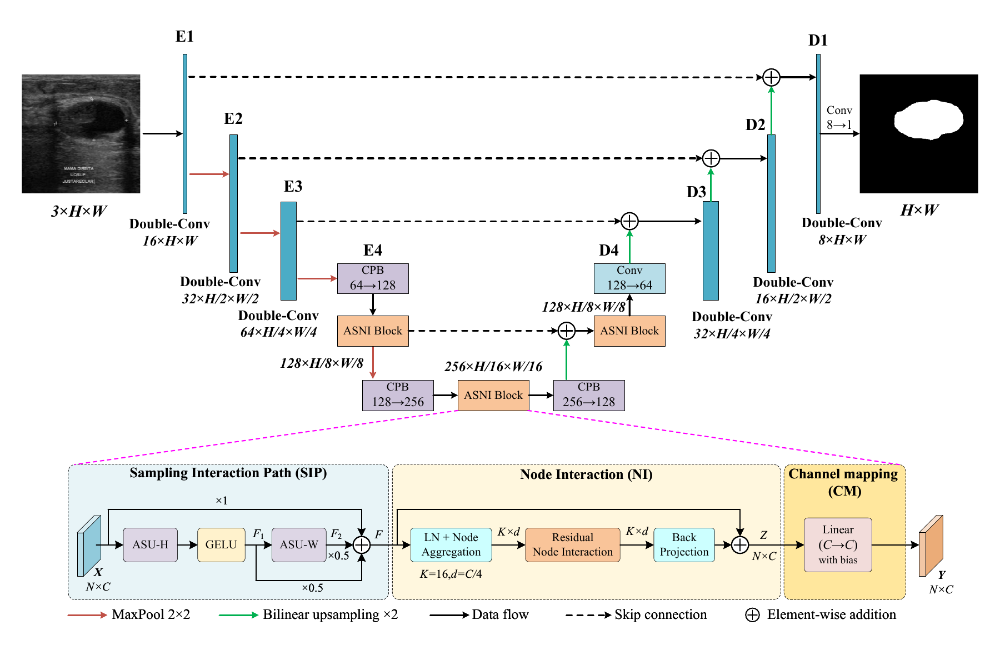
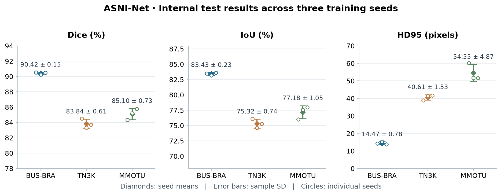

# ASNI-Net 中文说明

**用于二维超声病灶分割的自适应采样与节点交互网络。**

[English / 仓库首页](README.md) · [论文—代码对应](docs/PAPER_TO_CODE.md) · [权重索引](docs/MODEL_ZOO.md) · [完整复现](docs/REPRODUCING.md)

本项目对应论文《ASNI-Net: An Adaptive Sampling and Node Interaction Network for 2D Ultrasound Lesion Segmentation》。
提供正式模型、三个数据集各三个种子的九份配置与权重、固定划分、训练恢复、原图尺寸评价及逐图结果。

本仓库为审稿用代码版本；完整作者与文献引用信息将在审稿结束后补充。

## 模型结构

该图与论文图1一致。ASNI块依次连接 **SIP → NI → CM**；三个块通道数为128/256/128，节点数K=16。
完整网络登记参数量约1.45M，输入采用512×512等比例缩放与补边。
[采样单元（图2）](assets/adaptive_sampling.png) · [节点交互（图3）](assets/node_interaction.png)

## 实验结果

以下为论文表3中的ASNI-Net结果，均为三个训练种子的均值±样本标准差。

| 数据集 | Dice ↑ (%) | IoU ↑ (%) | HD95 ↓ (像素) |
|---|---:|---:|---:|
| BUS-BRA | 90.42 ± 0.15 | 83.43 ± 0.23 | 14.47 ± 0.78 |
| TN3K | 83.84 ± 0.61 | 75.32 ± 0.74 | 40.61 ± 1.53 |
| MMOTU lesion subset | 85.10 ± 0.73 | 77.18 ± 1.05 | 54.55 ± 4.87 |

BUS-BRA按病例/患者等权汇总，TN3K和MMOTU按图像汇总；MMOTU为固定病灶子集。
外部BUS-UCLM使用BUS-BRA/20260928单份权重，不能当作三种子结果。

## 使用步骤

1. 按[英文首页](README.md#quick-start)创建Python 3.12环境并安装；CPU可先运行自动检查。
2. 在[数据说明](docs/DATASETS.md)找到原发布方，下载数据后用`prepare`和`verify-data`重建并核对固定划分。
3. 按[权重索引](docs/MODEL_ZOO.md)选择配置和权重，运行`evaluate`；单图预测使用`predict`。
4. 如需重新训练，按[复现指南](docs/REPRODUCING.md)运行`train`；`last.pt`用于完整恢复，`best.pt`用于评价。
5. `summarize`汇总种子结果，`inspect`导出采样偏移和节点权重，`benchmark`进行独立前向计时。

## 复现范围

项目聚焦正式ASNI-Net，不包含其他比较网络或替代消融网络。模型初始化、RNG、前向/反向与优化器更新经过冻结源码对照；
九份权重和完整MMOTU验证集82张图的重构一致性已核验。本次发布没有重做完整科学训练或GPU实验。
论文各章节、图表与代码的具体关系见[对应索引](docs/PAPER_TO_CODE.md)。

结构图和展示样例的来源见[图像说明](assets/README.md)，版权和代码许可统一列于[LICENSE](LICENSE)。
软件引用信息见[CITATION.cff](CITATION.cff)。
